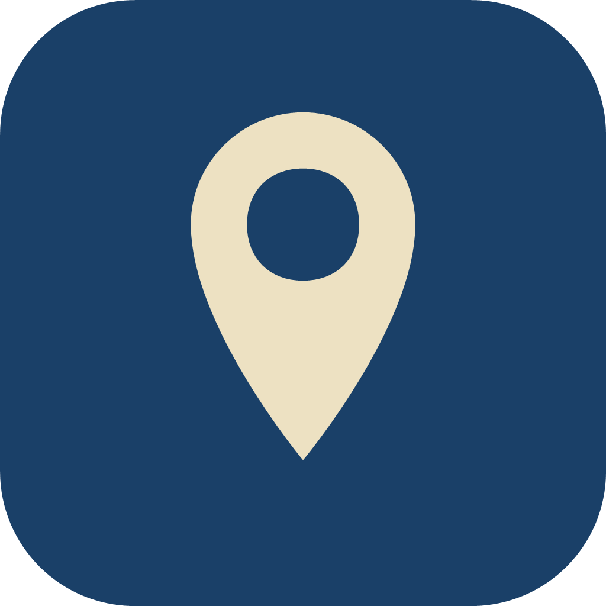

  
  <h1>单车地图</h1>
  

    
    
  

  
单车地图是一个用于查看地图中心附近共享车辆、按编号定位车辆、生成车辆二维码，并提供本地提醒的 Android 工具。

> **非官方工具**：与任何车辆品牌、运营平台及第三方服务均无隶属、合作或授权关系。

> **升级提示**：2.0.0 及之后的正式版共用同一签名，可直接覆盖安装，本机设置与记录保留；1.0.1 及更早版本为旧签名，需先卸载旧版再安装。

## 功能

- **地图与车辆**：查看附近车辆的位置、电量、距离、状态和数据上报时间，支持定位与地图缩放。
- **车辆过滤**：默认自动过滤离线、停用或低电量等不可用车辆；可在“设置 → 车辆显示”中关闭。
- **按编号定位**：输入完整 9 位编号后直接查询并定位该车辆位置，不受内置目录命中范围限制；3–4 位尾号匹配依赖内置目录。
- **编号数据**：随版本内置车辆编号目录，并按需在本机记住查到过的编号与校园名，用于补全显示。
- **二维码**：支持按 3–4 位尾号或完整 9 位编号生成二维码，可保存到相册、复制链接或跳转微信扫一扫。
- **提醒**：提供 15 分钟计时，支持提前 1、3、5、7、10 分钟提醒，以及响铃并震动、仅震动、静默通知；设备重启或应用覆盖更新后会自动恢复未结束的提醒。
- **车辆预警**：在高级设置中启用，可按 10 秒、30 秒、1 分钟、3 分钟或 5 分钟检测附近车辆。
- **外观与设置**：支持浅色、深色和跟随系统主题；可管理二维码链接、最近记录、车辆预警和地图缓存。
- **问题排查**：可在“关于 → 问题排查”中导出或清除诊断日志（仅本机记录，可开关详细模式），便于反馈问题时定位。

## 使用

1. 首次启动时阅读并同意免责声明。
2. 授予定位权限，查看当前位置和附近车辆。
3. 选择车辆生成二维码，或输入车辆编号：查到该车时直接在地图上定位，查不到时仍可按编号生成二维码。
4. 点击左侧提醒按钮设置提醒；车辆预警需要在“高级设置”中开启。

## 安装与升级

- 请从 GitHub Releases 下载正式版 APK。
- 2.0.0 及之后的版本共用同一签名，可以覆盖升级，本机设置与记录保留。
- 1.0.1 及更早版本为旧签名，无法覆盖安装，必须先卸载旧版；卸载会清除旧版应用数据。

## 数据与权限

应用只在相关功能需要时申请定位、通知、精确闹钟等权限。查询附近车辆时，地图中心坐标会发送至第三方数据接口；按编号查询单车时，会发送该车辆编号和查询坐标。地图瓦片由高德开放平台加载。提醒设置和最近车辆编号保存在设备本地，详细说明见 [PRIVACY.md](PRIVACY.md)。

## 免责声明

本应用为个人独立开发的非官方工具，软件按“现状”提供，不提供明示或默示担保。请自行判断并按当地规定使用。

## 文档

- [安全与隐私](PRIVACY.md)
- [第三方组件与服务](THIRD_PARTY_NOTICES.md)
- [开发说明](DEVELOPER.md)

## License

Copyright (C) 2026 dlkz

原创代码按 [GNU Affero General Public License v3.0](LICENSE)（AGPL-3.0）授权。第三方组件继续适用其各自许可证，详见 [THIRD_PARTY_NOTICES.md](THIRD_PARTY_NOTICES.md)。
