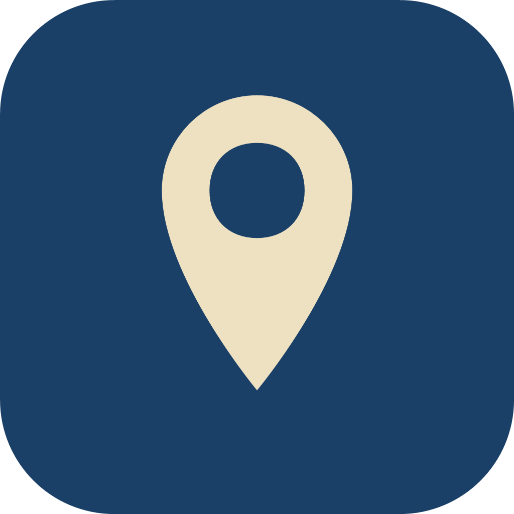

  
  <h1>单车地图</h1>
  

    
    
  

  
单车地图是一个用于查看地图中心附近共享车辆、按编号定位车辆、估算寻车方向、生成车辆二维码，并提供本地提醒的 Android 工具。

> **非官方工具**：与任何车辆品牌、运营平台及第三方服务均无隶属、合作或授权关系。

> **升级提示**：2.0.0 及之后的正式版共用同一签名，可直接覆盖安装，本机设置与记录保留；1.0.1 及更早版本为旧签名，需先卸载旧版再安装。

## 已支持的校园站点

内置编号目录当前覆盖以下 8 个站点：

- 东华理工大学
- 江西师范大学
- 江西科技师范大学（枫林校区）
- 江西科技师范大学（红角洲校区）
- 江西水利电力大学
- 南昌航空大学
- 南昌交通学院
- 南昌应用技术师范学院

名单来自应用内置的车辆编号目录，随版本更新。未列出的校区仍可通过完整 9 位车辆编号查询。

以上仅为编号数据的覆盖范围，不代表与上述学校或运营方存在任何合作或授权关系。

## 功能

- **地图与车辆**：查看附近车辆的位置、电量、距离、状态和数据上报时间，支持定位与地图缩放；顶部车辆统计按当前地图视口显示，选中并定位车辆后会随镜头更新。
- **车辆过滤**：默认自动过滤离线、停用或低电量等不可用车辆；可在“设置 → 车辆显示”中关闭。
- **车辆列表**：可选择地图卡片或半屏列表作为默认样式；打开后可继续拖动和缩放地图，并可上拉或下拉切换两种显示状态。卡片上的“定位”只移动地图，点击卡片其他区域查看车辆信息。
- **地图估算寻车**：对有位置数据的车辆显示估算距离，并标明当前使用最后上报位置还是已刷新位置；车辆位置超过 2 分钟时进入寻车页会自动进行一次有界刷新。方向只使用同一份已采纳的当前位置计算，并按定位误差与车距的比例判断是否可靠；短距离需要更高定位精度，误差相对车距过大时隐藏箭头。短暂降级最多保留 8 秒最后方向，但用户移动或方向变化明显时立即取消保持。指南针连续稳定后才显示相对方向。车辆位置过期时使用“最后位置”或“位置已过期”文案，不把旧坐标表述成实时车辆方向。刷新时会同时更新车辆最新上报位置和手机当前位置。
- **蓝牙找车**：非 2 序列车辆在接口提供 `xlc-...` 蓝牙广播名称时，可在寻车页主动开启前台 BLE 扫描，按广播名称精确匹配目标。远端信号只用于面板提示，连续样本稳定进入较强档后才接管中央距离；短暂无广播先提示信号减弱，8 秒未恢复才确认丢失。方向箭头仍按地图位置和手机方向计算；停止扫描后恢复地图估算。该功能不提供精确米数或 BLE 方向；2 序列车辆暂不支持。
- **最近寻车**：点击车辆详情中的“寻找车辆”，或从二维码弹窗跳转微信扫一扫前，应用可在本机保存最近 3 辆车的寻车快照，包括完整车辆编号、车辆地图坐标、车辆数据上报时间、快照保存时间、查询到的蓝牙名称和校园/站点名。车辆被租走后即使匿名接口不再返回，也可从“车辆编号 → 最近寻车”重新进入寻车页；刷新遇到租用中的车辆时会静默保留已有位置。关闭“保留最近车辆编号”或清除记录时一并删除。
- **按编号定位**：输入完整 9 位编号后直接查询并定位该车辆位置，不受内置目录命中范围限制；3–4 位尾号匹配依赖内置目录。
- **编号数据**：随版本内置车辆编号目录，并按需在本机记住查到过的编号与校园名，用于补全显示。
- **二维码**：支持按 3–4 位尾号或完整 9 位编号生成二维码，可保存到相册、复制链接或跳转微信扫一扫。
- **提醒**：提供 15 分钟计时，支持提前 1、3、5、7、10 分钟提醒，以及响铃并震动、仅震动、静默通知；设备重启或应用覆盖更新后会自动恢复未结束的提醒。
- **车辆预警**：在高级设置中启用，可按 10 秒、30 秒、1 分钟、3 分钟或 5 分钟检测当前位置 100 米内的可用车辆；少于 3 辆时提醒，恢复到 4 辆以上时解除。定位或通知权限被撤销时预警会暂停并保留开关，权限恢复后自动继续。部分 Android 版本可能限制后台启动定位前台服务，此时预警会安全暂停，重新打开应用后恢复。
- **外观与设置**：支持浅色、深色和跟随系统主题；可管理二维码链接、最近记录、车辆预警和地图缓存。
- **问题排查**：可在“关于 → 问题排查”中导出或清除诊断日志（仅本机记录，可开关详细模式），便于反馈问题时定位。

## 使用

1. 首次启动时阅读并同意免责声明。
2. 授予定位权限，查看当前位置和附近车辆。
3. 选择车辆查看信息、估算寻车或生成二维码；接近车辆后可按需开启蓝牙找车（2 序列除外）。
4. 点击左侧提醒按钮设置提醒；车辆预警需要在“高级设置”中开启。

## 安装与升级

- 请从 GitHub Releases 下载正式版 APK。
- 2.0.0 及之后的版本共用同一签名，可以覆盖升级，本机设置与记录保留。
- 1.0.1 及更早版本为旧签名，无法覆盖安装，必须先卸载旧版；卸载会清除旧版应用数据。

## 数据与权限

应用只在相关功能需要时申请定位、附近设备、通知、精确闹钟等权限。查询附近车辆时，地图中心坐标会发送至第三方数据接口；按编号查询单车、寻车页自动处理过期位置或补充蓝牙名称、在寻车页主动刷新车辆位置时，会发送对应车辆编号和查询坐标；车辆预警在满 20 辆且低库存时最多追加 4 个偏移点查询，坐标同样发送至该接口。蓝牙扫描只在寻车页由用户主动开启并保持前台，用于匹配当前车辆广播名称，不上传扫描结果。地图瓦片由高德开放平台加载，瓦片坐标会隐含当前浏览区域。提醒设置、最近车辆编号和最多 3 条最近寻车快照保存在设备本地，详细说明见 [PRIVACY.md](PRIVACY.md)。

## 免责声明

本应用为个人独立开发的非官方工具，软件按“现状”提供，不提供明示或默示担保。请自行判断并按当地规定使用。

## 文档

- [安全与隐私](PRIVACY.md)
- [第三方组件与服务](THIRD_PARTY_NOTICES.md)
- [开发说明](DEVELOPER.md)

## License

Copyright (C) 2026 dlkz

原创代码按 [GNU Affero General Public License v3.0](LICENSE)（AGPL-3.0）授权。第三方组件继续适用其各自许可证，详见 [THIRD_PARTY_NOTICES.md](THIRD_PARTY_NOTICES.md)。
